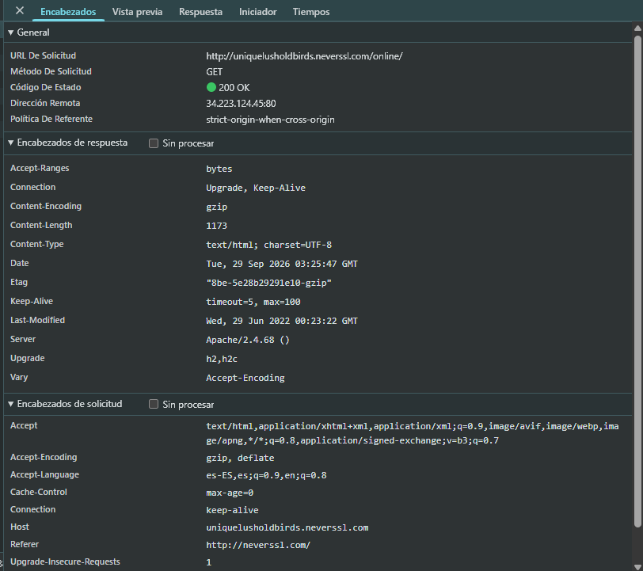
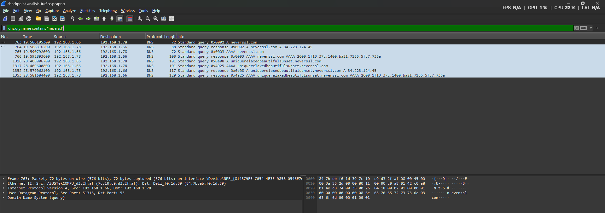
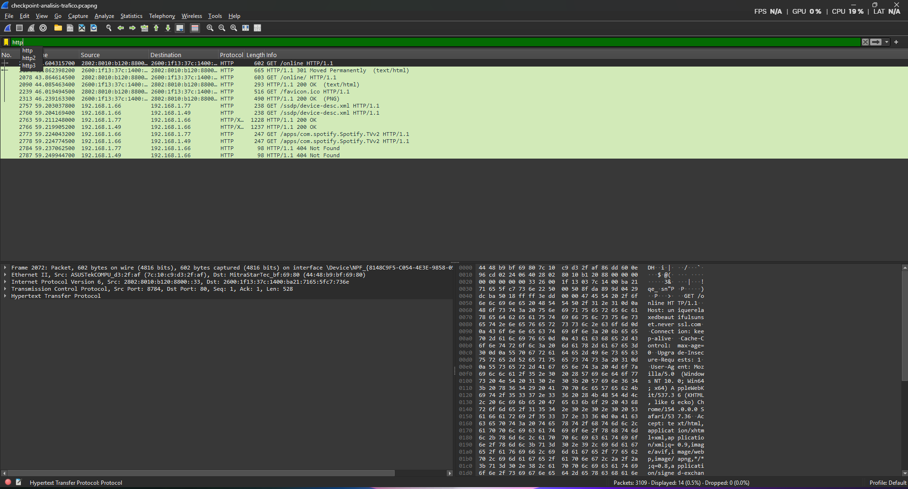

# Informe de Auditoría de Red Wi-Fi Insegura

## Introducción

En esta práctica se analiza el comportamiento de una navegación web realizada mediante HTTP con el objetivo de comprender qué información puede quedar expuesta al utilizar una red Wi-Fi pública o no confiable.

El análisis se realizó sobre el sitio:

```text
http://neverssl.com
```

Para obtener las evidencias se utilizaron dos herramientas:

- **Chrome DevTools**, mediante la pestaña Network.
- **Wireshark**, mediante una captura de tráfico almacenada en formato `.pcapng`.

El objetivo es identificar el protocolo utilizado, localizar solicitudes HTTP, analizar los datos que pueden observarse cuando no existe cifrado, comparar HTTP con HTTPS y explicar cómo cambiaría la captura de tráfico al utilizar una VPN.

---

## Sitio analizado

El sitio utilizado para la práctica fue:

```text
http://neverssl.com
```

NeverSSL permite establecer conexiones mediante HTTP sin forzar automáticamente el uso de HTTPS, por lo que resulta útil para observar las diferencias entre tráfico web sin cifrar y comunicaciones protegidas.

---

# 1. Exploración mediante Chrome DevTools

Se accedió a NeverSSL y se utilizaron las herramientas de desarrollador del navegador mediante:

```text
F12 > Network
```

Luego se recargó la página y se seleccionó una de las solicitudes HTTP realizadas por el navegador.

## Evidencia de navegación


En la pestaña **Network** se observa la solicitud correspondiente al sitio analizado.

---

## Encabezados HTTP



En la evidencia se identificaron los siguientes datos:

- **URL solicitada:** `http://uniquelusholdbirds.neverssl.com/online/`
- **Método HTTP:** `GET`
- **Código de estado:** `200 OK`
- **Dirección remota:** `34.223.124.45:80`
- **Host:** `uniquelusholdbirds.neverssl.com`
- **Referer:** `http://neverssl.com/`
- **Puerto:** `80`
- **Protocolo:** HTTP
- Encabezados HTTP enviados por el navegador.

Estos datos pueden visualizarse porque HTTP no proporciona cifrado del contenido de la comunicación.

---

# 2. Análisis de la captura con Wireshark

Además del análisis realizado desde el navegador, se utilizó **Wireshark** para capturar y analizar el tráfico generado durante la navegación.

El archivo original de captura utilizado como evidencia se encuentra en:

```text
evidencias/checkpoint-analisis-trafico.pcapng
```

El formato `.pcapng` permite conservar los paquetes capturados para analizarlos posteriormente mediante Wireshark.

---

## Resolución DNS

Durante el análisis se aplicó un filtro DNS para identificar la resolución del dominio NeverSSL.



En la captura puede observarse el proceso mediante el cual el equipo consulta el sistema DNS para obtener la dirección IP correspondiente al dominio.

Entre las respuestas observadas aparece la dirección IPv4:

```text
34.223.124.45
```

Esto demuestra que, antes de establecer la comunicación HTTP, el navegador necesita resolver el nombre del dominio a una dirección IP.

---

## Tráfico HTTP y solicitud GET

Para localizar el tráfico HTTP en Wireshark se utilizó el filtro:

```text
http
```



En la captura se observan solicitudes HTTP realizadas mediante el método:

```text
GET
```

Entre ellas se identifica:

```text
GET /online/ HTTP/1.1
```

La información obtenida en Wireshark se complementa con los encabezados observados mediante DevTools, donde se identifica la URL completa:

```text
http://uniquelusholdbirds.neverssl.com/online/
```

y el host:

```text
uniquelusholdbirds.neverssl.com
```

Debido a que la comunicación utiliza HTTP, estos elementos pueden observarse sin necesidad de descifrar el tráfico.

---

# 3. ¿Qué protocolo utiliza el sitio?

El sitio utiliza **HTTP (Hypertext Transfer Protocol)**.

HTTP permite transferir información entre un cliente y un servidor web, pero no incorpora cifrado de la información transmitida.

En las evidencias se observa el uso del puerto:

```text
TCP 80
```

que es el puerto tradicional utilizado por HTTP.

Esto significa que un dispositivo con capacidad para observar el tráfico podría identificar información transmitida durante la comunicación.

---

# 4. ¿Qué información puede observarse durante una solicitud HTTP?

Durante la práctica fue posible observar directamente diferentes elementos de la comunicación.

Entre ellos:

- Dirección IP de origen y destino.
- Puerto de comunicación.
- Host de destino.
- URL solicitada.
- Método HTTP `GET`.
- URI solicitada.
- Encabezados HTTP.
- `Referer`.
- Información del navegador mediante encabezados como `User-Agent`.
- Código de respuesta HTTP.
- Información de sesión si la aplicación la transmitiera sin protección.

Por ejemplo, durante la práctica se observó:

```text
GET /online/ HTTP/1.1
```

junto con el host:

```text
uniquelusholdbirds.neverssl.com
```

y la URL:

```text
http://uniquelusholdbirds.neverssl.com/online/
```

La posibilidad de visualizar esta información demuestra la falta de confidencialidad de HTTP.

---

# 5. Riesgos de HTTP en una red Wi-Fi pública

En una red Wi-Fi pública pueden existir dispositivos desconocidos conectados a la misma infraestructura.

Si una aplicación utiliza HTTP, un atacante que logre posicionarse de manera adecuada para observar el tráfico podría intentar obtener información transmitida sin cifrar.

Dependiendo de la aplicación, podrían quedar expuestos:

- URLs visitadas.
- Hosts consultados.
- Encabezados HTTP.
- Cookies transmitidas sin protección.
- Datos introducidos en formularios.
- Información de sesión.
- Credenciales si una aplicación insegura las enviara mediante HTTP.
- Otra información sensible transportada sin cifrado.

Además de observar información, un atacante situado entre el usuario y el servidor podría intentar realizar ataques de tipo **Man-in-the-Middle (MITM)**.

En ese escenario podría intentar:

- Interceptar comunicaciones.
- Modificar respuestas HTTP.
- Redirigir solicitudes.
- Insertar contenido malicioso.
- Capturar información sensible transmitida sin protección.

Por esta razón HTTP no debe utilizarse para transmitir credenciales, información bancaria u otros datos sensibles.

---

# 6. Diferencias entre HTTP y HTTPS

## HTTP

HTTP transmite la información sin proporcionar cifrado a nivel de aplicación.

Esto permite que determinados elementos de la comunicación puedan ser observados directamente mediante herramientas de análisis de tráfico como Wireshark.

Por ejemplo:

```text
GET /online/ HTTP/1.1
Host: uniquelusholdbirds.neverssl.com
```

pueden identificarse directamente cuando se utiliza HTTP.

---

## HTTPS

HTTPS combina HTTP con **TLS (Transport Layer Security)**.

TLS proporciona principalmente:

- **Confidencialidad:** cifra el contenido de la comunicación.
- **Integridad:** permite detectar modificaciones no autorizadas.
- **Autenticación:** permite verificar la identidad del servidor mediante certificados digitales.

Normalmente HTTPS utiliza:

```text
TCP 443
```

Al analizar tráfico HTTPS con Wireshark todavía pueden observarse ciertos metadatos de red, como:

- Direcciones IP.
- Puertos.
- Tamaño de los paquetes.
- Tiempos de comunicación.

Sin embargo, el contenido de aplicación protegido mediante TLS no puede leerse directamente como ocurre con HTTP.

Por lo tanto, no sería posible observar de la misma manera elementos como:

```text
GET /online/
```

ni el contenido de formularios o respuestas HTTP protegidas dentro de la sesión TLS.

---

# 7. Simulación de tráfico utilizando una VPN en Wireshark

Una **VPN (Virtual Private Network)** crea un túnel cifrado entre el dispositivo del usuario y el servidor VPN.

Esto cambia significativamente lo que un observador situado en la red Wi-Fi local podría visualizar mediante Wireshark.

## Sin VPN

Sin utilizar una VPN, una captura de tráfico HTTP puede permitir identificar directamente elementos como:

- Dirección IP del servidor web.
- Puerto utilizado.
- Solicitudes HTTP.
- Método `GET`.
- URI.
- Host.
- Encabezados.
- Contenido transmitido sin cifrar.

Esto puede observarse en la evidencia obtenida durante esta práctica.

---

## Con VPN

Al activar una VPN, el tráfico original se encapsula dentro de un **túnel cifrado** entre el equipo y el servidor VPN.

Wireshark seguiría capturando paquetes en la interfaz de red, pero desde el punto de vista de un observador situado en la red Wi-Fi local se observaría principalmente la comunicación entre:

```text
Equipo del usuario <-> Servidor VPN
```

En lugar de observar directamente cada comunicación original hacia los diferentes sitios visitados.

El observador todavía podría identificar ciertos metadatos, por ejemplo:

- Dirección IP del servidor VPN.
- Puerto utilizado por el protocolo VPN.
- Cantidad de tráfico.
- Tamaño de los paquetes.
- Horarios y duración de las conexiones.

Sin embargo, el contenido encapsulado dentro del túnel VPN no podría inspeccionarse directamente.

Por ejemplo, dejarían de ser visibles para un observador de la red local elementos como:

- Método HTTP `GET`.
- URL completa solicitada.
- URI.
- Encabezados HTTP.
- Contenido de formularios.
- Contenido de las páginas transportado dentro del túnel.

---

## ¿Qué aporta una VPN?

Una VPN proporciona principalmente:

### Cifrado

El tráfico entre el dispositivo y el servidor VPN se encuentra cifrado.

### Túnel seguro

Las comunicaciones se encapsulan dentro de un túnel protegido.

### Protección del tráfico

Dificulta que otros usuarios conectados a una red Wi-Fi pública puedan inspeccionar directamente las comunicaciones originales.

### Privacidad

Los sitios de Internet normalmente observan como dirección de origen la IP pública del servidor VPN en lugar de la IP pública original del usuario.

---

## Una VPN no reemplaza HTTPS

Aunque una VPN agrega una capa adicional de protección, **no sustituye a HTTPS**.

La VPN protege principalmente el tramo:

```text
Dispositivo -> Servidor VPN
```

HTTPS, en cambio, protege la comunicación entre:

```text
Navegador -> Servidor web
```

Por esta razón, una configuración más segura consiste en utilizar:

```text
HTTPS + VPN
```

cuando se navega desde una red pública o no confiable.

---

# 8. Mis 3 Reglas de Oro para navegar en redes Wi-Fi públicas

## Regla 1 - Utilizar HTTPS y verificar el dominio

Antes de ingresar contraseñas, datos personales o información bancaria, verificar que el sitio utilice HTTPS y que el dominio sea realmente el esperado.

No se deben ignorar advertencias de certificados emitidas por el navegador.

---

## Regla 2 - Utilizar una VPN en redes públicas o no confiables

Una VPN agrega una capa de protección mediante un túnel cifrado entre el dispositivo y el servidor VPN.

Esto reduce la posibilidad de que otros dispositivos de la red local puedan inspeccionar directamente el tráfico generado por el usuario.

---

## Regla 3 - Evitar operaciones sensibles cuando no sean necesarias

En redes Wi-Fi públicas se recomienda evitar:

- Banca online.
- Pagos.
- Transferencias.
- Acceso a sistemas corporativos sensibles.
- Envío de información confidencial.

Cuando sea posible, es preferible utilizar:

- Datos móviles.
- Una red privada de confianza.
- HTTPS.
- Una VPN confiable.

---

# 9. Conclusiones

La práctica permitió comprobar de forma técnica y visual los riesgos asociados al uso de HTTP.

Mediante Chrome DevTools fue posible identificar la URL completa, el método `GET`, el Host, el código de respuesta y diferentes encabezados HTTP.

El análisis de la captura `.pcapng` mediante Wireshark permitió observar además el proceso de resolución DNS y solicitudes HTTP como:

```text
GET /online/ HTTP/1.1
```

Esto demuestra que HTTP no proporciona confidencialidad suficiente para transmitir información sensible.

HTTPS mejora significativamente la seguridad al utilizar TLS para proporcionar cifrado, integridad y autenticación.

Por otra parte, una VPN agrega una capa adicional de protección al crear un túnel cifrado entre el dispositivo y el servidor VPN. En una captura realizada desde la red local, el contenido original quedaría encapsulado y dejarían de observarse directamente elementos como solicitudes GET, URLs completas y encabezados HTTP.

La combinación de **HTTPS, una VPN confiable y buenas prácticas de navegación** reduce considerablemente los riesgos al utilizar redes Wi-Fi públicas.

---

# Evidencias incluidas

Las evidencias utilizadas en esta auditoría se encuentran dentro de la carpeta:

```text
/evidencias
```

Contenido:

```text
01-neverssl-network.png
02-neverssl-http-headers.png
03-wireshark-dns-neverssl.png
04-wireshark-http-neverssl.png
checkpoint-analisis-trafico.pcapng
```

El archivo `.pcapng` permite abrir nuevamente la captura completa mediante Wireshark para verificar los paquetes analizados.