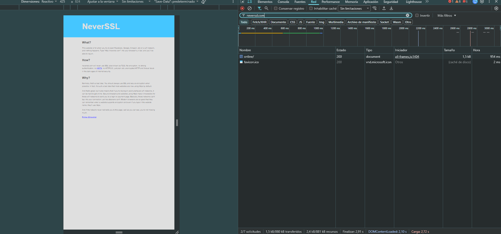

# Informe de Auditoría de Red Wi-Fi Insegura

## Introducción

En esta práctica se analiza el comportamiento de una navegación web realizada mediante HTTP con el objetivo de comprender qué información puede quedar expuesta en una red Wi-Fi pública o no confiable.

El análisis se realizó sobre el sitio `http://neverssl.com` utilizando las herramientas de desarrollador del navegador, específicamente la pestaña **Network / Red**.

El objetivo es identificar el protocolo utilizado, observar qué datos viajan visibles durante una solicitud HTTP, describir los riesgos asociados y explicar cómo una VPN puede reducir la exposición del tráfico.

---

## Sitio analizado

Sitio utilizado:

```text
http://neverssl.com
```

NeverSSL está diseñado para mantener una conexión HTTP sin redirección automática a HTTPS, por lo que resulta útil para observar tráfico web sin cifrado.

---

## Evidencia observada

### Captura general de la navegación



En la pestaña **Network** se observa la solicitud principal de tipo `document` correspondiente al sitio analizado.

### Encabezados HTTP


En la captura de encabezados se identificaron los siguientes datos:

- **URL solicitada:** `http://uniquelusholdbirds.neverssl.com/online/`
- **Método HTTP:** `GET`
- **Código de estado:** `200 OK`
- **Dirección remota:** `34.223.124.45:80`
- **Host:** `uniquelusholdbirds.neverssl.com`
- **Referer:** `http://neverssl.com/`
- **Puerto utilizado:** `80`
- Diversos encabezados HTTP enviados por el navegador.

---

## 1. ¿Qué protocolo utiliza el sitio?

El sitio utiliza **HTTP**.

HTTP permite transferir información entre el navegador y el servidor, pero no proporciona cifrado por sí mismo. En la evidencia se observa el uso del puerto `80`, habitual para HTTP.

A diferencia de HTTPS, HTTP no utiliza TLS para proteger el contenido de la comunicación.

---

## 2. ¿Qué información puede observarse durante la solicitud?

Durante la solicitud fue posible observar directamente varios elementos, entre ellos:

- Host de destino.
- URL solicitada.
- Método `GET`.
- Encabezados HTTP.
- Referer.
- Información del navegador mediante encabezados como `User-Agent`.
- Dirección IP y puerto remoto.

Esto demuestra que una conexión HTTP ofrece poca confidencialidad frente a un tercero que pueda interceptar el tráfico.

---

## 3. Riesgos de navegar mediante HTTP en una red Wi-Fi pública

En una red Wi-Fi pública, un atacante con capacidad de observar el tráfico podría interceptar información transmitida mediante HTTP.

Dependiendo de la aplicación utilizada, podrían quedar expuestos:

- URLs visitadas.
- Encabezados HTTP.
- Cookies transmitidas sin protección adecuada.
- Datos introducidos en formularios.
- Información de sesión.
- Credenciales si una aplicación insegura las enviara por HTTP.

Además de leer información, un atacante situado entre el usuario y el servidor podría intentar modificar el tráfico, redirigir solicitudes o insertar contenido malicioso.

Por este motivo no es recomendable utilizar HTTP para transmitir información sensible.

---

## 4. ¿Cómo ayuda una VPN?

Una VPN crea un **túnel cifrado** entre el dispositivo del usuario y el servidor VPN.

Cuando se utiliza una VPN, los dispositivos intermedios de la red Wi-Fi local no pueden inspeccionar directamente el contenido transportado dentro de ese túnel.

Una VPN aporta principalmente:

- **Cifrado:** protege el tráfico entre el equipo y el servidor VPN.
- **Túnel seguro:** encapsula las comunicaciones de red.
- **Protección frente a observadores locales:** dificulta la inspección del tráfico por otros usuarios de una Wi-Fi pública.
- **Privacidad:** el sitio de destino observa la dirección IP del servidor VPN en lugar de la IP pública original del usuario.

Sin embargo, una VPN **no reemplaza HTTPS**. Lo ideal es utilizar HTTPS siempre que sea posible y considerar una VPN como una capa adicional de protección, especialmente en redes públicas o no confiables.

---

## 5. Mis 3 Reglas de Oro para navegar en redes Wi-Fi públicas

### 1. Evitar sitios HTTP y verificar HTTPS

Antes de ingresar credenciales o información personal, comprobar que el sitio utilice HTTPS y que el dominio sea el esperado.

### 2. Utilizar una VPN en redes no confiables

Una VPN reduce la posibilidad de que otros usuarios de la red local inspeccionen directamente el tráfico del dispositivo.

### 3. No realizar operaciones sensibles si no es necesario

Evitar ingresar a banca online, realizar pagos o transmitir información confidencial desde redes públicas. Cuando sea posible, utilizar datos móviles o una red de confianza.

---

## Conclusión

La práctica permitió comprobar de manera directa la diferencia de seguridad existente entre HTTP y protocolos protegidos mediante cifrado.

La inspección de NeverSSL mostró que datos como el Host, la URL, el método HTTP, el Referer y distintos encabezados pueden visualizarse durante una comunicación HTTP.

En una red Wi-Fi pública, esta falta de cifrado puede facilitar la interceptación o manipulación del tráfico. El uso de HTTPS, combinado con buenas prácticas y una VPN cuando la red no es confiable, reduce significativamente el riesgo.

---

**Autor:** Julián Martín Batistutti  
**Curso:** Ciberseguridad - Coderhouse
